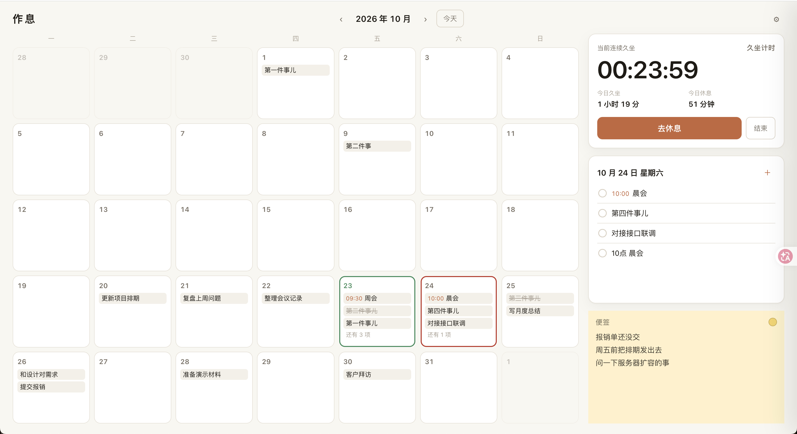
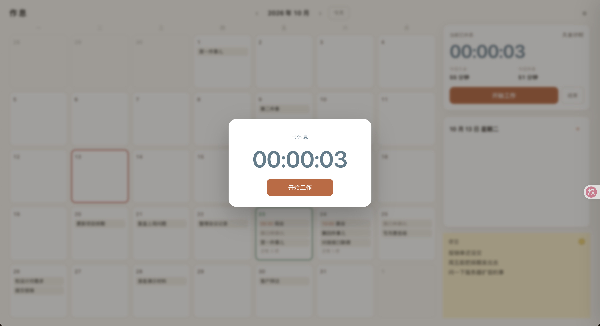
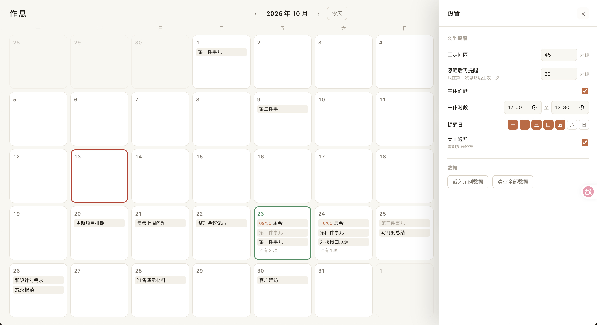

# 作息


一个月历装下排到月底的计划，同时盯着久坐时长。打开网页即用，无注册、无后端、无数据库，数据存在浏览器本地，不上传。

**在线版**：https://wwjay1024.github.io/zuoxi-work-planner/

## 功能

- **月历**：只显示周一至周五，可拖拽事项改期，点格子查看当日全部事项。
- **当日事项**：新增、编辑、勾选完成、删除与撤销。
- **久坐计时**：开始工作 / 去休息 / 结束三个动作，跨刷新与机器挂起都能正确结算。
- **提醒**：连续久坐满间隔弹全屏遮罩，午休静默，默认仅工作日。
- **便签**：单张便利贴，六种颜色可选。
- **设置抽屉**：提醒参数、示例数据、清空数据。

## 截图

| 工作中 | 已休息 |
| --- | --- |
|  |  |

| 休息提醒 | 设置 |
| --- | --- |
|  |  |

## 本地运行

纯静态站点，无需安装依赖。进入 `zuoxi/` 目录起任意静态服务器：

```bash
cd zuoxi
python3 -m http.server 8000
```

打开 `http://localhost:8000/`。

## 数据与隐私

数据存在浏览器 `localStorage`（键名 `zuoxi.state.v1`），同一浏览器同一域名共享一份，不同浏览器和设备各自独立。没有账号登录、多设备同步、云端备份或数据上传。清除浏览器数据会丢失日程。

## 部署

`zuoxi/` 是要发布的全部内容。推送到 `main` 分支后，`.github/workflows/deploy-pages.yml` 会自动把该目录发布到 GitHub Pages。

## 目录结构

```
zuoxi/
├── index.html          页面结构
├── styles.css          样式（含深色模式）
├── screenshots/        四张功能截图
└── js/
    ├── main.js         启动装配与模块订阅
    ├── store.js        状态读写、localStorage 持久化
    ├── calendar.js     月历渲染、拖拽改期、月份切换
    ├── daypanel.js     当日事项列表
    ├── sitting.js      久坐状态机、计时、提醒规则
    ├── notes.js        便签
    ├── settings.js     设置抽屉
    └── ui.js           弹层、撤销条、确认框
.github/workflows/
└── deploy-pages.yml    推送后自动发布到 GitHub Pages
```

## 许可证

见仓库根目录 `LICENSE`（MIT）。
